# Retake (working name)

Retake is a video review tool for working with an AI agent. You watch a version of a video, press **R**, and talk
and draw over it. Your notes are pinned to the exact moment and spot. An agent reads them, makes the next version,
and asks you when it isn't sure. You flip between the old and new version with **C**.

It runs on your machine: one `retake` binary serves the review page, keeps the notes and talks to agents over a CLI
and MCP. An optional editor, `retake-edit`, renders videos from a timeline file that an agent changes through
patches.

> Status: not released yet. The name "retake" and the license aren't decided. Milestones 1 (the player) and 2 (notes,
> agent API, questions) are done, and the editor's first slice is in. See [`docs/roadmap.md`](docs/roadmap.md).

## How it works



Watch a version, press **R**, talk and draw over it, and press **Send**. One agent edits the project on your computer,
only the parts that changed render again, and each note turns Done as its change lands in the next version.

- `retake open clip_v6.mp4` finds the other versions of the clip by name (`clip_v5.mp4`, `../v7/clip_v7.mp4`, …).
  Versions can be single files or `.m3u8` playlists.
- Each review is a *take*, saved next to the video in `<name>.review/<timestamp>/`: one audio file per segment, the
  strokes and images, and the events that tie the two clocks together ([spec/take-format.md](spec/take-format.md)).
  Audio stays in the browser until the server has it, so a crash or a closed tab loses nothing.
- When you press Done, the server transcribes the take and turns it into notes. Each note has its text, time, strokes
  and a snapshot of the frame. They're kept in `<project>/.retake/project.db`.
- An agent reads the notes, makes the next version with any tool, and pushes it with a changelog. A push is refused
  until every open note is either answered or asked about ([docs/agents.md](docs/agents.md)).
- Each version keeps its own comments, and a comment on v7 becomes an edit in v8. The comments panel shows the version
  on screen; its version menu lists every version with where its comments go and what's still to do ("v7 → v8 · 3 to
  do").

<!-- Setup picture: it belongs with the Install section (one click). -->


## Quickstart (5 minutes)

You need [mise](https://mise.jdx.dev) (it installs the pinned Go, node and Rust) and ffmpeg.

```bash
mise install
mise exec -- make build                                  # bin/retake, with the page built in
(cd editor && mise exec -- cargo build --release)        # editor/target/release/retake-edit
export PATH="$PWD/bin:$PWD/editor/target/release:$PATH"

scripts/make-sample.sh ~/retake-sample                   # a short how-to video, v1 and v2, all generated
cd ~/retake-sample
retake open how-to/v2/how-to_v2.mp4                      # the review page opens in your browser
```

1. Play to step two (about 0:11) and pause.
2. Press **R**, say "the labels at the bottom are too small", and draw a loop around the label.
3. Press **R** again, then **Done**.
4. Run `retake notes sync how-to/v2/how-to_v2.mp4`, then `retake notes list how-to/v2/how-to_v2.mp4`.
5. Let an agent answer the note and push v3 ([docs/agents.md](docs/agents.md)), or do its part by hand
   ([docs/quickstart.md](docs/quickstart.md), step 5).
6. Run `retake open how-to/v3/how-to_v3.mp4` and press **C** to flip between v3 and v2 at the same moment.

No microphone? `scripts/make-sample.sh ~/retake-sample --with-take` adds a recorded take for you. Turning speech into
text needs whisper.cpp (`scripts/install-whisper.sh`); the sample's take comes with its transcript, so step 4 works
without it. The full walkthrough is in [docs/quickstart.md](docs/quickstart.md).

## Keys

| Key | Does |
|---|---|
| **R** | Start or stop recording your voice. Without it, draw or type a comment at any moment (the box at the bottom of the comments; Enter saves it, Esc cancels it). |
| Space or K | Play or pause. |
| ← / → | Back or forward 5 seconds. |
| , / . | One frame back or forward. |
| 1 2 3 4 | Pen color: red, yellow, green, white. |
| E | Eraser: swipe over any line on screen to remove it, recording or not. A pen color (1–4) switches back to the pen. |
| Z (or Ctrl+Z) | Undo the last stroke or image, or bring back the last line you erased. |
| **C** | Flip to the comparison version at the same moment, and back. Its comments and markers come with it. |
| N | Show or hide the notes sidebar. |
| F | Fullscreen. |
| Ctrl+S | Save now. The page also saves on its own. |
| Esc | Cancel a stroke, close the version list. |

To switch to any other version, use the version list in the bar or the row of versions over the comments. `[` and
`]` are not keys any more.

While recording you can also drag or paste an image onto the video. It's pinned to that moment and spot.

## On a phone

The review page has a phone layout, portrait and landscape, with big buttons for record, Send, undo and the pen
colors, and the version list to switch versions. Safari records AAC (`seg_NN.m4a`), which retake reads like any other segment.

A browser only allows the microphone on a secure page: `http://127.0.0.1` on the same machine, or HTTPS. To review
from a phone, run `retake share clip_v2.mp4`: it opens an HTTPS tunnel and prints a link with a QR code. Only people
with a valid link get in (see [Sharing](#sharing)).

## Connect an agent



Bring the agent you already use: Claude Code, Codex or any command-line agent. Each video gets one agent, which takes
all of that video's notes.

There's nothing to connect. In a timeline project, with Claude Code or Codex installed and signed in:

```bash
retake open ~/Videos
```

Open a video, press R, talk and draw, press R again, then **Send**. The agent edits the project on this computer,
the page plays the edit as it renders, and the comment turns Done when the new version is ready. If something is
missing, one line over Send says what; the agent, its fallback and connecting a computer are in Settings, at the bottom
of the home's left column. Hold Send to pick another agent for one send. [docs/agents.md](docs/agents.md) covers other providers (OpenRouter, API keys)
and driving your own agent over MCP (`retake mcp <video>`) or the CLI.



What powers the agent is your own account: a Claude or ChatGPT subscription, an API key, or OpenRouter for any model.
Set it once in Settings, and hold Send to pick another agent for one send.



Agents run in the background, in herdr (it comes with Retake) or in tmux. In herdr or tmux you can open any agent's
session and talk to it, and when it's unsure, its question lands on the video at the shot it's about
([docs/agents.md](docs/agents.md#watch-and-talk-to-your-agents-herdr-tmux)).

## Works with any tool



An agent can use any tool it can reach: an MCP server, a command line or an API (ElevenLabs voices, image generation,
Blender, ffmpeg). Retake doesn't need to know which: it watches the project's files and renders what changed.

## Editing with the timeline



The renderer cuts a video into parts and caches each one, so an edit renders only the parts it touched. Several
videos render at once on one computer, and the page plays the new version while it renders.

`retake-edit` renders a timeline file (an edit as data, changed only through patches) into a video and a manifest. In
a timeline project, the review loop runs on it:

```bash
retake-edit patch apply edit/timeline.json edit/patches/02-v3.json   # the patch says which note it answers
retake push how-to/v2/how-to_v2.mp4 --render --parent v2             # registers v3; streams when watched
```

- `retake push --render` registers the current revision with a poster. Opening it starts a growing stream; closing
  the last viewer stops rendering, and reopening resumes from the cache. Only changed units draw again.
  Each patch's note ids and summary become the changelog. Use `--no-stream` to wait for a completed MP4.
- `retake open <folder>` shows the folder as a tree on the left (folders, projects, their videos) and the videos as
  thumbnails with their review status, and Next video. `retake share <folder>` shares that home screen.
- Notes point at the timeline elements under their strokes, so an agent knows what to patch.
- C and the version list land on the matching moment when a trim moved things, not on the same clock time.
- The newest version shows the parent's notes as unchanged, answered (check it), or context changed.

[docs/timeline.md](docs/timeline.md) explains the format and the loop.

## Components and the shared library

Motion graphics and edit styles are code anyone can share: a component is a JSON file with a props schema and layers
(no After Effects, no MOGRT), a brand kit holds the tokens and the house rules, and a registry is a static
`index.json`. `library/` has ten CC0 components (titles, pops, lower thirds, karaoke captions, picture-in-picture, a
progress bar, zoom punches, counters, callouts, freeze-frame highlights) and a kit:

```bash
scripts/build-registry.sh                                   # library/index.json
retake lib add pop-text --registry library/index.json      # vendored into components/, pinned in timeline.lock
retake-edit lint edit/timeline.json                        # "pop overlaps pop at 0:12.3–0:12.5; one pop at a time"
```

A component change re-renders only the elements that use it, and upgrades are per element. Agents get
`component_describe` (with the storybook sheet as an image), `lib_search`, `lib_add` and `lint`. See
[spec/components.md](spec/components.md) and [library/README.md](library/README.md).

## Sharing

`retake share clip_v6.mp4 --label alex` puts the review behind an HTTPS tunnel (cloudflared, or `--tunnel tailscale`)
and prints a link with a QR code. A link is a viewer, reviewer (the default) or approver; it expires (24 h by default),
and `retake share revoke` ends it early. Reviewers press the same Send you do, and their comments go to your agent. Agents elsewhere use `/mcp` with `retake token create --role agent`. Local use
needs no token. See [`docs/sharing.md`](docs/sharing.md).

## Hosting



Retake has two halves: the page and the comments, and your computer, where the footage and the agent live. Working
alone, they're one program on your computer. Hosted, the page is online and your computer connects out to it, so the
footage never uploads.

Want people to review without being at your computer? Host it, in two commands:

1. On a server: `cd deploy && docker compose up -d` (one container, one volume). Open the setup link it prints
   (`docker compose logs retake`) and create your account.
2. On your computer, in your projects folder, run the line the next page shows:
   `retake connect https://review.example.com --token rk_…`.

Your footage never leaves your computer: it connects out to the server, which relays only the video someone is
watching, and your agents run where they always do. Reviewers sign in with one-time links (no passwords) or use a
share link. See [docs/hosting.md](docs/hosting.md), and [deploy/README.md](deploy/README.md) for HTTPS, Postgres and
MinIO, backups and upgrades.

## Assets

`retake assets import media/ --license owned` catalogs a project's footage, audio, images and fonts (plus a user
library and brand kits), with previews an agent can look at, labeled moments (spans) and licenses.
`retake assets search "…"` finds them; `retake assets license-report <timeline|manifest>` lists publish blockers and
credits. Agents get the same tools over MCP, and plug-ins add domain data. See [docs/plugins.md](docs/plugins.md).

## Install

There are no releases yet. Once there are, this installs `retake` (and with `--with-editor`, `retake-edit`) into
`~/.local/bin` after checking the archive's SHA-256:

```bash
curl -fsSL <release URL>/install.sh | sh -s -- --with-editor
```

Until then, build from source as in the quickstart. `retake version` prints the version.

## Docs

- [docs/quickstart.md](docs/quickstart.md): the whole loop on the sample project, step by step.
- [docs/agents.md](docs/agents.md): connecting Claude Code, Codex or any MCP client.
- [docs/config.md](docs/config.md): every config key and environment variable.
- [docs/hosting.md](docs/hosting.md): hosting Retake for other people, and connecting your computer to it.
- [deploy/README.md](deploy/README.md): the self-hosting reference (HTTPS, transcription, mail, backups).
- [docs/timeline.md](docs/timeline.md): the editor's timeline format, as a guide.
- [docs/releasing.md](docs/releasing.md): versions, release archives, the installer and the license notices.
- [spec/](spec/): the contracts. [api.md](spec/api.md) (HTTP), [take-format.md](spec/take-format.md),
  [notes.md](spec/notes.md) (notes, questions, agent API), [team.md](spec/team.md) (sharing),
  [server.md](spec/server.md) (the team server), [timeline.md](spec/timeline.md), [manifest.md](spec/manifest.md).
- [CONTRIBUTING.md](CONTRIBUTING.md): development setup and tests.
- [CHANGELOG.md](CHANGELOG.md).

## License

Not decided yet, so there is no LICENSE file. Third-party software in the binaries is listed in
[THIRD_PARTY_NOTICES.md](THIRD_PARTY_NOTICES.md). The sample project in `examples/sample/` is CC0.
